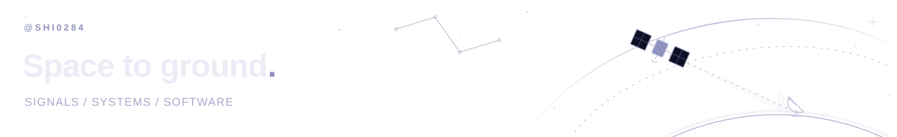
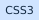

## About Me

Hi, I'm **Hyein Seo**, a **Software Convergence** undergraduate at **Kyung Hee University** (enrolled in **2024**).

I'm interested in **satellite ground station systems**, especially telemetry processing, real-time flight data visualization, and mission monitoring.

I'm also exploring **AI and computer vision**, with an interest in how these techniques can help interpret satellite and mission data.

## Interests

Telemetry processing, real-time flight data visualization, and mission control tools.

Orbital and mission analysis, and how space and ground systems work together.

Image recognition and learning-based models for practical, data-driven applications.

## Tech Stack

### Languages

  
  
  
  
  
  

### AI & Computer Vision

  
  
  
  

### Web · App · Tools

  
  
  
  
  

